# Архитектура MVP «Событийного радара»

Система обнаруживает значимые события в первоисточниках эмитентов, формирует доказательные сигналы по облигациям и адресно предупреждает их держателей. Это read-only decision support: система не даёт торговых указаний и не выполняет операции.

Физически MVP состоит из модульного backend, асинхронных workers и отдельного LLM inference. Показанные компоненты являются логическими модулями, а не обязательными микросервисами.

## Схема

```mermaid
flowchart LR
  subgraph EXT["Внешние источники"]
    DISC["Раскрытия и отчётность<br/>ЦРКИ, e-disclosure"]
    MARKET["Мосбиржа<br/>цены, спреды, объёмы"]
    POS["T-Invest API<br/>позиции клиентов"]
    OPTIONAL["Дополнительные адаптеры<br/>суды, налоги, рейтинги"]
  end

  subgraph ANALYTICS["Аналитический контур — без клиентских позиций"]
    INGEST["Scheduler + connectors"]
    RAW[("Object storage<br/>неизменяемые документы")]
    QUEUE["Оркестратор + durable queue<br/>retry · DLQ · replay"]
    NORMAL["Нормализация и OCR<br/>Markdown + таблицы"]
    EXTRACT["Специализированные<br/>LLM-извлекатели"]
    LLM["Model gateway<br/>open-weight LLM"]
    TOOLS["MCP tools<br/>read-only · allowlist"]
    VALIDATE["Валидация JSON,<br/>цитат и обязательных полей"]
    LINK["Справочный слой<br/>ISIN · ИНН · issuer ID"]
    FACTS[("PostgreSQL<br/>факты · связи · сигналы<br/>market snapshots · версии")]
    VECTOR[("pgvector<br/>версионированный RAG-индекс")]
    SCORE["Правила + прогнозная модель<br/>ухудшение на 30/90 дней"]
    POLICY["Политика решения<br/>notify / review / suppress"]
    EXPLAIN["Модуль объяснений<br/>LLM + цитаты первоисточника"]
    REVIEW["Очередь аналитика<br/>подтвердить · исправить · отклонить"]
    OUTBOX[("Transactional outbox<br/>атомарно с решением notify")]
    TRAIN["Offline point-in-time training<br/>outcome labels + model registry"]
  end

  subgraph CLIENT["Клиентский контур"]
    MATCH["Рекомендательная функция MVP<br/>правила сопоставления + exposure"]
    DELIVERY["Идемпотентная доставка"]
    APP["In-app карточка<br/>+ optional push"]
    QA["Read-only grounded chat<br/>без торговых инструментов"]
  end

  OBS["Observability<br/>trace_id · метрики · аудит"]

  DISC --> INGEST
  OPTIONAL -.-> INGEST
  INGEST --> RAW --> QUEUE --> NORMAL --> EXTRACT
  EXTRACT <--> LLM
  EXTRACT <--> TOOLS
  EXTRACT --> VALIDATE --> LINK --> FACTS
  NORMAL --> VECTOR
  MARKET --> FACTS
  FACTS --> SCORE
  SCORE --> POLICY
  POLICY -->|notify| OUTBOX
  POLICY -->|review| REVIEW
  REVIEW -->|approved| OUTBOX
  REVIEW -->|исправления| FACTS
  OUTBOX --> EXPLAIN
  FACTS --> EXPLAIN
  EXPLAIN <--> LLM
  EXPLAIN --> MATCH --> DELIVERY --> APP
  POS --> MATCH
  FACTS --> QA
  VECTOR --> QA
  APP <--> QA
  FACTS -. "offline snapshot" .-> TRAIN
  REVIEW -. "разметка" .-> TRAIN
  TRAIN -. "одобренная версия" .-> SCORE
  QUEUE -.-> OBS
  POLICY -.-> OBS
  DELIVERY -.-> OBS
```

## Основной сценарий

1. Scheduler опрашивает раскрытия каждые 15 минут. Загрузчик сохраняет документ и его хеш; повторная обработка не создаёт дубликаты.
2. Workers нормализуют PDF/HTML/XML, при необходимости выполняют OCR. Оркестратор направляет документ специализированным LLM-извлекателям.
3. LLM возвращает JSON по схеме типа события. Валидатор требует точную цитату, место в документе, обязательные поля и версии модели и промпта.
4. Справочный слой связывает факты с юрлицом, группой и выпуском. Неоднозначная связь получает `requires_review` и не попадает в автоматическую доставку.
5. Правила и версионированная прогнозная модель формируют оценку; политика выбирает `notify`, `review` или `suppress`. LLM не участвует в числовом скоринге.
6. Решение `notify` — от политики или после одобрения аналитиком — и запись в outbox сохраняются атомарно. Worker outbox запускает модуль объяснений, который формирует текст только по подтверждённым фактам и цитатам; сбой LLM вызывает retry того же события, а не новое решение.
7. Рекомендательная функция MVP по детерминированным правилам сопоставляет объяснение с держателями, определяет приоритет и добавляет exposure; отдельная ML-рекомендательная модель не используется.
8. Новые документы обновляют существующий сигнал. Повторное уведомление возможно при смене типа или статуса события, связанного выпуска либо при переходе политики в `notify` из другого состояния. Колебания скоринга без смены решения повторного уведомления не вызывают.

## Интерфейсы и хранилища

| Компонент | Ответственность |
|---|---|
| Object storage | Исходные документы, хеши и версии; replay без повторной загрузки |
| PostgreSQL | Факты, связи, point-in-time рыночные snapshots, сигналы, задачи, outbox, разметка и аудит |
| pgvector / RAG | Поиск только по версионированному корпусу для объяснений и чата с фильтрацией по разрешённому сигналу |
| Model gateway | Единый inference-интерфейс, позволяющий заменять локальную open-weight LLM |
| MCP tools | Read-only доступ LLM к явно разрешённым инструментам; не является хранилищем или model gateway |
| Model registry | Одобренные версии модели; отдельный offline point-in-time training |
| Модуль объяснений | Формирует текст и карточку по подтверждённым фактам и цитатам; не влияет на скоринг и политику |
| Рекомендательная функция MVP | Правила сопоставления с держателями и приоритизации; ML-рекомендательная модель не требуется |

## Надёжность, безопасность и качество

- Аналитический контур не получает клиентские позиции. Чат видит только разрешённые данные сигнала и не имеет торговых инструментов; позиции не попадают в обычные логи.
- Каждый факт и сигнал воспроизводим по документу, цитате, правилам, промпту и версиям моделей, справочников и рыночных snapshots. `trace_id` связывает все стадии.
- Retry, DLQ, идемпотентность и transactional outbox исключают тихие потери и повторные уведомления.
- Для документов, справочников и рыночных данных различаются `event_at` и `known_at`: в ретроспективном прогнозе доступны только данные, известные на его момент.
- Метки фактического исхода появляются после истечения горизонта и служат только для обучения и оценки; они не входят в признаки прогноза.
- Цель MVP — 95% автоматических веток до `notify`, `suppress` или постановки в `review` не более чем через 30 минут после успешной загрузки. Ожидание аналитика измеряется отдельно.
- Сбой или устаревание источника отображается явно: отсутствие данных не означает отсутствие риска.
- Оценки аналитика и обратная связь клиентов сохраняются, но автоматическое online-переобучение запрещено.
- Read-only интерфейс и дисклеймер не заменяют комплаенс-оценку персонализированного уведомления.

## Проверка MVP

Отдельно измеряются полнота и корректность извлечения, точность цитат и связей, качество прогноза, доля ручных проверок, задержка конвейера и полезность уведомлений. Полезным считается уведомление, которое аналитик признал фактически корректным, правильно связанным с бумагой и достойным внимания инвестора. Ретроспективный эксперимент сравнивает систему с базовыми правилами и фиксирует версии всех артефактов; целевая доля полезных уведомлений — не менее 50%.
